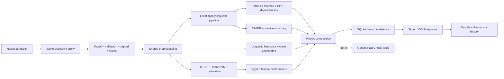

# VeriFact AI architecture

## Boundaries

- `frontend/src/components`: presentation and forms. Query caching belongs to TanStack Query; form validation uses React Hook Form/Zod. Theme preference is local browser state. Article text is rendered as React text, never HTML.
- `frontend/src/lib`: typed public contracts, API client, format utilities. The App Router proxy forwards only content type, cookies, and origin; the backend URL is never a browser secret.
- `backend/app/api`: transport validation, routing, pagination, session filtering, real database statistics.
- `backend/app/services`: report orchestration, URL/PDF extraction, language observations, optional evidence.
- `backend/app/ml`: consistent preprocessing and swappable classifier protocol. Baseline feature attributions come from the fitted linear pipeline; transformer adapter deliberately provides no unsupported attribution.
- `backend/app/models`, `db`, `alembic`: relational persistence and versioned migrations. SQLite provides durable development storage. PostgreSQL is selected by `DATABASE_URL`.
- `backend/training`: original data ingestion, leakage reduction, validation search, holdout evaluation, trusted artifact serialization.

## Request lifecycle

1. The browser obtains a signed HttpOnly anonymous session cookie. Validity is checked with HMAC-SHA256. New session IDs use cryptographic randomness.
2. The user enters content, or asks the backend to extract URL/file content for review. Original document bytes are discarded.
3. Zod prevents short/oversized input. FastAPI independently normalizes and validates it and checks longer input language with seeded `langdetect`.
4. TF-IDF transforms the cleaned text using the fitted training vocabulary. The linear SVM returns a decision score, then a separately fitted sigmoid calibrator produces class estimates. A fixed confidence threshold and input-length/coverage checks mark uncertain inputs. No 160-word US-political gate is applied to full articles.
5. Signed TF-IDF × SVM coefficient × calibration-slope values explain model associations. Separately, explicit phrase patterns produce language highlights and sentence rules select exact candidate claims.
6. Evidence is queried only if server credentials, server enablement, and per-request consent are all present. Relationships remain inconclusive; query similarity never establishes agreement.
7. One database transaction stores the report, insights, claim rows, and any retrieved evidence. Failed persistence returns an error; success means the report is saved.
8. The frontend renders real returned values and navigates to the report ID. Reloading retrieves the session-authorized stored report. Dashboard data is aggregated exclusively from that session's rows.

## Persistence and privacy

A report contains article text, model outputs, timestamp, language observations, and candidate claims. Foreign-key relationships cascade on deletion. No global public history endpoint exists. Session expiry is one year; records do not auto-expire, so deployers must define a retention policy. Losing the browser cookie loses access; no account recovery is implemented.

PostgreSQL migrations enable RLS and revoke public/anon/authenticated access. The backend must use the protected owner role or a deliberately configured privileged server role. This application does not use Supabase client-side Data API access or Supabase Auth. Anonymous browser sessions are authorized in FastAPI, not through `auth.uid()`.

The development limiter is process-local and also keyed by IP; shared deployments need a trusted reverse proxy and a shared limiter. Proxy deployments must not trust arbitrary forwarded IP headers.

## NLP and model lifecycle

`services/nlp.py` caches a local trained English pipeline. Startup loads it off the event loop. Its optional report payload adds annotations without changing existing relational history records. Summary ranking considers the first 200 sentences; entity/token/dependency detail is capped, and the UI discloses the limits. `/api/nlp/explore` runs this pipeline without database persistence or evidence requests.

The classifier loader supports legacy baseline and calibrated hybrid artifacts. Calibration-group contributions reconstruct the calibrated logit; semantic features are never presented as token explanations. The selected challenger is lexical. Active metrics are bundled with their model and checked against its version. `training/improve.py` never promotes a candidate automatically. `training/operating_policy.py` selects a scope-plus-confidence policy on validation and records its test coverage and uncertainty interval.

Historical reports retain their original model versions. New unsupported inputs withhold numerical reliability scores. All inference is local, and serving never downloads weights. See [training report](IMPROVEMENT-REPORT.md) for the rejected challenger and the precise accuracy/coverage tradeoff.

## Current article release

The default trusted artifact is `artifacts/articles/model.joblib`, with matching bundled evaluation metadata. `ArticleClassifier` returns an article assessment and factual-verification status separately. Legacy classifiers remain loadable. `training/articles.py` prepares group-disjoint partitions, selects an SVM on validation and fits probability calibration on separate groups. Raw datasets never pass through browser code.

URL extraction first fetches a validated public resource. MSN shells can be resolved through a fixed public CDN endpoint, independently DNS-validated and pinned. JSON-LD fallback reads only public Article/NewsArticle bodies and respects explicit paywall flags; scripts are never executed. No general arbitrary URL proxy or credential forwarding is introduced.
